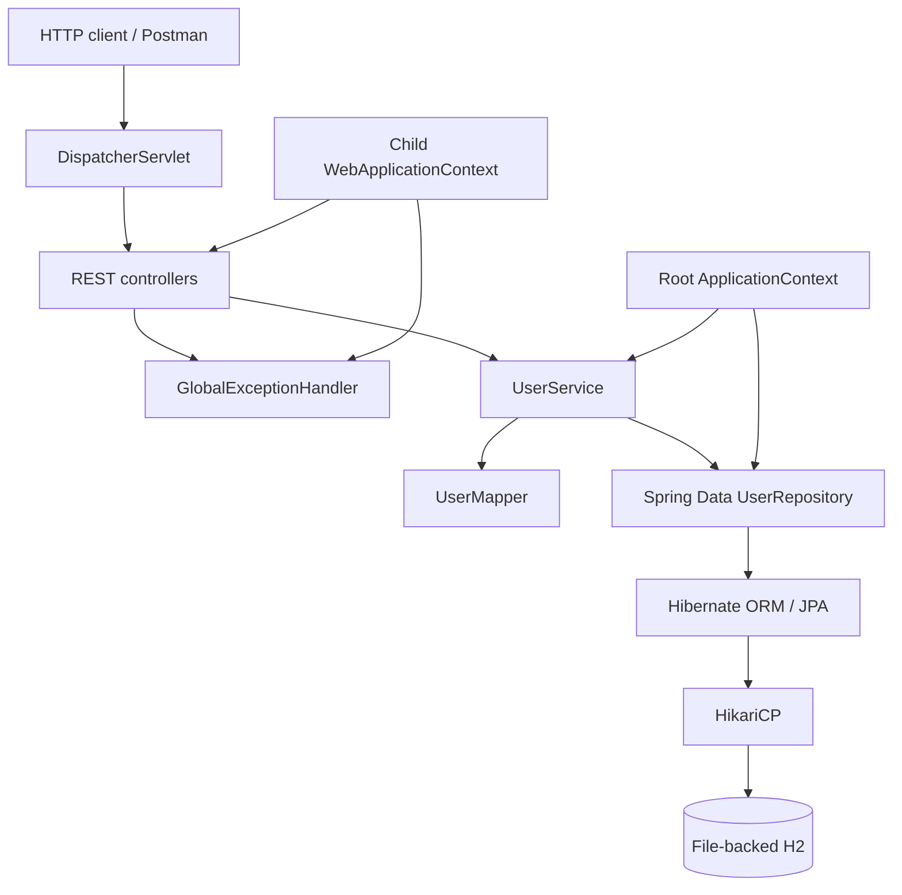

# Architecture

This project is a Java 17 WAR using Spring Framework 6.1, Spring MVC, Spring Data JPA, Hibernate 6.4, H2, and Tomcat 10.1. It uses manual Java configuration and does not use Spring Boot.

## Spring configuration

`AppInitializer` creates a root context from `RootConfig` and a child MVC context from `WebMvcConfig`, maps the `DispatcherServlet` to `/`, and installs a UTF-8 character-encoding filter. There are no authentication filters. The root context owns persistence, repositories, services, and mappers; the child context owns controllers and exception advice.

`PersistenceConfig` configures HikariCP, the Hibernate `EntityManagerFactory`, Spring Data repositories, and transaction management. The JPA entity scan is limited to `com.usermanagementapi.model`.

## Request and persistence flow

Controllers use validated request DTOs and return `UserResponse` DTOs; JPA entities are never serialized directly. The service layer performs email normalization/uniqueness checks, BCrypt password hashing and verification, active-user filtering, and logical deactivation. The mapper only converts DTOs and entities.

## Database location

The default H2 database is stored at:

`%USERPROFILE%\\.user-management-api\\data\\user_management_db.mv.db`

The same absolute user-home path is used regardless of IntelliJ's or Tomcat's current working directory. Override `db.directory` and `db.url` in an externalized application properties source if another persistent location is needed. Back up the database file while the application is stopped.

This application intentionally has no authentication or authorization and is for learning only; it is not production-ready.
